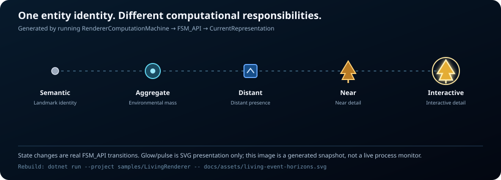
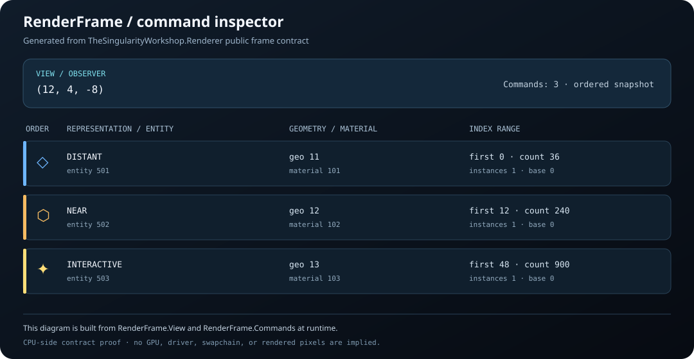
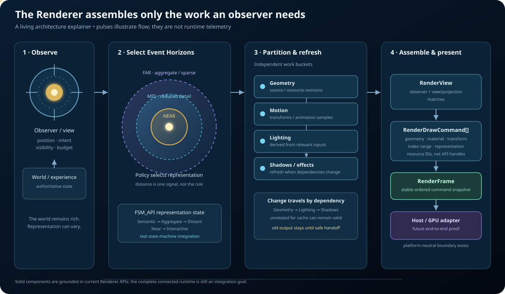

# Renderer Gallery

**Choose the right work for the observer before handing it to presentation.**

This is the brief index. Each exhibit links to the document that explains its recipe, source, and evidence. The current SVGs are generated snapshots; they are not live telemetry. The [SVG living-documentation guide](SVG_LIVING_DOCUMENTATION.md) contains the full technical explanation. The [per-file UML source index](UML/README.md) tracks audited C# types and explicitly lists coverage still pending.

## Start here — One observer, two worlds

A single change of observer position has two complementary views: Renderer exposes the decision as structured, inspectable frame data; Visualize and GUI.SVG manifest that decision as a picture. Follow the input through the computation and into the output rather than treating the SVG as decoration.

- **Renderer evidence:** [Observer moves: policy-to-frame](gallery/observer-driven-frame.md) shows the selected representation and index-work change for a deterministic fixture.
- **Downstream manifestation:** [Observer-driven presentation proof](https://github.com/TrentBest/TheSingularityWorkshop.Visualize/blob/development/docs/gallery/observer-driven-presentation.md) runs the observer policy at X=0 and X=50, adapts two real Renderer frames, and generates two SVGs plus a machine-readable report.
- **Inspect the source:** [Visualize proof program](https://github.com/TrentBest/TheSingularityWorkshop.Visualize/blob/development/integrations/GuiSvg/ObserverFrameProof/Program.cs) · [Renderer frame contracts](../src/).
- **Understand the boundary:** Renderer owns observer-relative decisions and platform-neutral commands; Visualize consumes frame/resource contracts; GUI.SVG serializes the optional SVG manifestation. This is CPU/SVG integration evidence, not GPU-produced pixels or a performance benchmark.

The exhibit is useful because the causal chain is testable: move the observer → policy selects different representations → frame commands carry those decisions → the adapter preserves identity and representation → the SVG output changes. The fixture geometry is deliberately simple; do not mistake it for a universal LOD policy or a production scene scheduler.

## 01 — Event Horizons: representation states

**See:** five FSM-backed computation machines advanced through actual state transitions; the generated SVG reads their resulting representation values. The glow, pulse, and motion are SVG presentation, not a live world.

**Recipe:** [Event Horizon state proof recipe](gallery/event-horizons.md).

## 02 — RenderFrame inspector: ordered work

**See:** observer position and the ordered CPU-side commands that downstream presentation can consume, including representation, entity, resource IDs, and draw ranges.

**Recipe:** [RenderFrame inspector recipe and run command](gallery/render-frame-inspector.md).

## 03 — Observer moves: policy-to-frame proof

The executable proof compares two observer positions against the same entity fixture. It calls Renderer’s real `ObserverDistance.Select`, builds real `RenderFrame` command snapshots, and asserts that selected representations and total index work change.

**Evidence boundary:** this is a deterministic CPU-side policy/frame proof. It does not submit GPU work, render pixels, or measure timing/allocations.

**Recipe:** [Observer-driven frame proof](gallery/observer-driven-frame.md). CI uploads the generated comparison as the `renderer-observer-driven-frame-proof` artifact.

## 04 — Observer → buckets → frame

This connected executable proof joins observer-distance selection, per-subject bucket invalidation, declared shadow dependencies, explicit reuse of unchanged buckets, and the resulting ordered `RenderFrame` commands. It asserts that changed representations refresh their dependent outputs while a subject that remains in the same representation records reuse.

**Evidence boundary:** actual CPU-side policy and bucket APIs plus real frame snapshots. It does not prove GPU submission, rendered pixels, production scheduling, or performance savings.

**Recipe:** [Observer-to-bucket-to-frame causal proof](gallery/observer-bucket-frame.md). CI uploads the SVG as the `renderer-observer-bucket-frame-proof` artifact.

## 05 — Bucket invalidation and cache reuse

This executable proof uses the real `EventHorizonBucket` and `EventHorizonBucketDependencyGraph` APIs. It changes a source revision, verifies that the changed bucket and its declared dependent are invalidated, confirms unrelated lighting and distant-motion buckets remain reusable, then accepts replacement refreshes. The SVG reports actual bucket metrics.

**Evidence boundary:** deterministic CPU-side invalidation, refresh-ticket, and explicit-reuse behavior. It does not measure GPU work avoided, timing, allocations, or rendered pixels.

**Recipe:** [Bucket invalidation and reuse proof](gallery/bucket-invalidation-and-reuse.md). CI uploads the generated SVG as `renderer-bucket-invalidation-reuse-proof`.

## 06 — Composition: where responsibilities live

**See:** the intended relationship between observer context, Event Horizons, work buckets, and frame assembly. This is an architecture illustration, not proof that all stages currently run end to end.

**Recipe:** [Composition and ownership recipe](gallery/composition-ownership.md).

---

[Architecture and ownership](../README.md) · [Development workflow](DEVELOPMENT.md)
