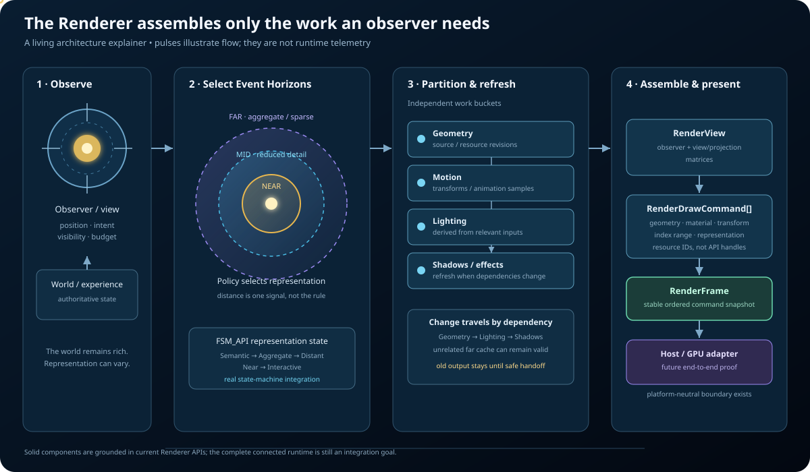

# Living Renderer — teach the system by showing it

The Renderer should be understandable by looking at it in action, not only by reading abstract contracts. These visuals are intended to make the computational model approachable to newcomers while remaining useful to implementers.

*This is an animated architecture explainer, not live telemetry. It maps current public Renderer concepts and APIs onto the intended flow; the connected observer-to-backend pipeline is not yet implemented as one end-to-end runtime.*

## What this image teaches

1. **Observe:** authoritative world/experience state and observer context are distinct inputs.
2. **Select:** Event Horizons describe how representation and computational responsibility can change. Distance is useful, but it is not the whole policy.
3. **Partition:** independent buckets can own different refresh cadence and validity. Dependency invalidation should touch dependent work rather than everything nearby.
4. **Assemble:** `RenderView`, `RenderDrawCommand`, and `RenderFrame` are real platform-neutral contracts. A `RenderFrame` is an ordered snapshot of commands, not a GPU execution by itself.
5. **Present:** a host or GPU adapter consumes the frame. A concrete backend connected to the selection and bucket path remains a proof milestone.

## The most important consumer is not necessarily a GPU\n\nEvent Horizons should also be demonstrated as a semantic observation system. A soldier agent should be able to consume structured facts such as “two friendly soldiers left” or “tank right,” plus horizon-level counts, uncertainty, and freshness—without performing visual recognition on rendered pixels. Visual representation and agent knowledge are distinct projections of authoritative world state; reducing one must not silently erase the other. The agent's behavior remains owned by its experience and FSM_API, not by Renderer. See [Semantic Observation](SEMANTIC_OBSERVATION.md) for the proposed consumption model and a broad implementation path.\n\n## First browser WebGPU policy handoff

Visualize's Soldier Field lab now consumes a deterministic `renderer-policy.json` generated by the real .NET `ObserverRepresentationPolicy` and `EventHorizon` types in this repository.

The first handoff is deliberately narrow:
- Renderer selects horizon, representation label, and preferred update frequency from explicit distance policy.
- A .NET sample advances each selected representation through `RendererComputationMachine`/FSM_API, then serializes the verified state transitions into a checked-in manifest with reproducible selection probes and an attention-floor example.
- Visualize loads that manifest in its browser WebGPU runner. Its distance and minimum-representation controls query the generated 9 × 5 Renderer decision matrix; default observer mode updates and draws only the selected horizon, while an explicit stress toggle runs all eight. Representation, cadence, reuse and policy-skip counters are shown together.
- CI regenerates the manifest from Renderer development source and verifies the browser input snapshot.

This is the first actual Renderer-policy-to-WebGPU workload connection. It does not yet run Renderer inside the browser, respond dynamically to live camera/focus changes, cull individual entities, promote/demote mesh fidelity, or invoke the Renderer/FSM_API bucket scheduler. The current Soldier Field workload deliberately repeats the selected population across all eight horizons as a stress fixture. Browser frame and JavaScript timing are not GPU execution measurements.

Visualize now uses the verified FSM state to allocate a fixed detail budget of 0 / 64 / 256 / 1,024 / 4,096 dust motes for Semantic / Aggregate / Distant / Near / Interactive. Each mote is an eight-triangle octahedron; Interactive therefore submits 32,768 additional detail triangles. This mapping is owned by Visualize: Renderer selects the representation state, and Visualize decides how much visual work that state receives. It is not yet screen-space adaptive, particle-physics driven, or GPU-timestamp measured.

The next proof should connect stable per-entity identity and observer position to live Renderer selection, then show that promotion/demotion changes actual geometry and submitted work without identity discontinuity.

## Build the evidence in layers

The next visuals should become progressively more executable:

- **Representation states:** already generated by running `RendererComputationMachine` through FSM_API.\n- **Semantic consumption:** build a deterministic world with soldiers, a tank, and obstruction; produce typed horizon summaries and feed them into a small FSM_API agent. Keep this a generated sample until it uses the actual production selection path.
- **Bucket invalidation:** run the actual dependency graph, change a source bucket, and show exactly which buckets become stale while an unrelated cache remains reusable.
- **Frame assembly:** construct a real `RenderFrame` from selected commands and visualize its actual command count and representation mix.
- **Observer change:** vary observer input and show selection/promotion/demotion, with the implemented policy clearly distinguished from any illustrative policy.
- **Backend proof:** send a real frame through a concrete presentation adapter and show the resulting image.
- **Performance proof:** plot measured work, allocations, and refresh counts against total population and observer-relevant population.

A visual should always say whether it is **live**, **generated from an executable test/sample**, or **conceptual**. SVG animation can make a static result feel alive, but it must never pretend to be a running simulation.

## Useful links

- [Architecture](ARCHITECTURE.md)
- [Event Horizon buckets](EVENT_HORIZON_BUCKETS.md)
- [GPU boundary](GPU_BOUNDARY.md)
- [Implementation roadmap](IMPLEMENTATION_ROADMAP.md)
- [Current FSM-backed representation snapshot](assets/living-event-horizons.svg)
