# Chapter 1 — The problem: a world is larger than one observer's needs

A simulated or described world may contain far more entities, effects, relationships, and history than one observer can inspect at once. Treating every entity as if it required maximum detail at every instant spends work without necessarily improving the observer's understanding.

The naive policy is uniform fidelity: update and represent everything at the same rate and resolution. Its cost tends to grow with the whole world, even when the observer is interested in only a small fraction of it.

Renderer investigates a different objective: spend computation according to the information an observer can use, while preserving identity, critical facts, and the ability to recover detail when it becomes relevant.

This is not a claim that invisible or distant entities cease to exist. Their authoritative state remains owned by the world or simulation. Renderer chooses only the observer-relative representation and work that should be materialized for a particular view.

### A useful distinction

- **Existence:** what the authoritative domain says exists.
- **Knowledge:** what a particular observer can currently infer or access.
- **Representation:** the form and fidelity used to communicate relevant aspects of that existence.
- **Execution:** the CPU, GPU, or other capability that performs selected work.
- **Presentation:** the concrete pixels, text, surface, or device output seen by a consumer.

Confusing these layers creates bugs. A distant mesh may be simplified without deleting the entity. A map observer may receive a semantic summary without receiving a rendered image. A GUI may show a control without owning the action's business rules.

> Part of the [Renderer theory learning path](RENDERING_THEORY.md). The [theory-to-implementation map](THEORY_IMPLEMENTATION_MAP.md) identifies current code, focused tests, and evidence limits.

[Theory index](RENDERING_THEORY.md) · [Next chapter](THEORY_02_OBSERVER_INPUT.md)

---

  
   
  <a href="https://github.com/TrentBest">GitHub</a> · <a href="https://github.com/TrentBest/TheSingularityWorkshop.Renderer">Renderer</a> · <a href="RENDERING_THEORY.md">Theory index</a>

## Implementation and evidence

**Source-checked:** [ObserverDistance.cs](../ObserverDistance.cs) and [ObserverRepresentationPolicy.cs](../ObserverRepresentationPolicy.cs) provide a concrete distance-to-representation path. The focused checks are [ObserverDistanceDeterminismTests.cs](../tests/TheSingularityWorkshop.Renderer.Tests/ObserverDistanceDeterminismTests.cs) and [ObserverRepresentationPolicyTests.cs](../tests/TheSingularityWorkshop.Renderer.Tests/ObserverRepresentationPolicyTests.cs).

**Limit:** these policies do not establish a universal optimality theorem or a complete production pipeline from authoritative world state to device output. They establish bounded behavior for the current contracts.

**Continue:** [Chapter 2 — The observer is part of the input](THEORY_02_OBSERVER_INPUT.md) and the [theory-to-implementation map](THEORY_IMPLEMENTATION_MAP.md).
