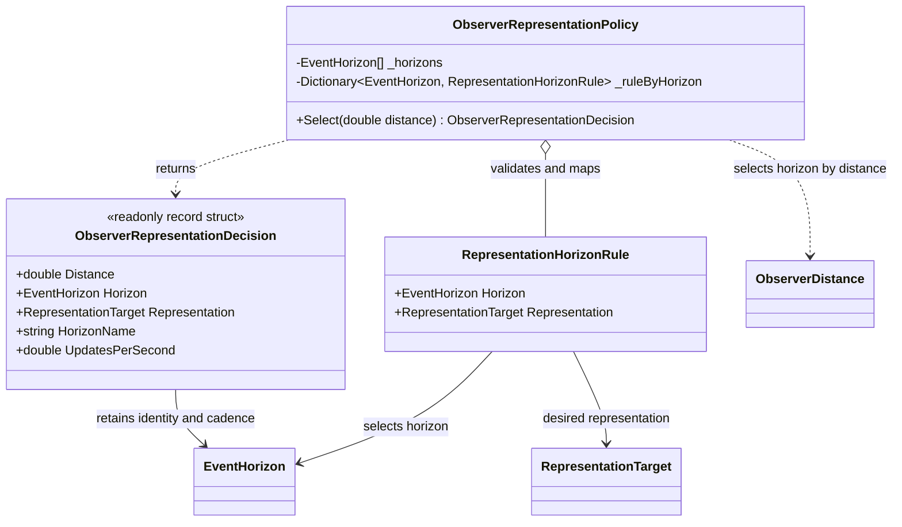

# ObserverRepresentationPolicy — class diagram

## Use case

The policy turns an observer distance into an explicit horizon and representation decision. A host can then map that decision to a computation bucket or rendering stage without parsing a display name.

## Boundary

The diagram describes policy selection only. It does not imply automatic FSM scheduling, occlusion handling, frame creation, or GPU execution.
