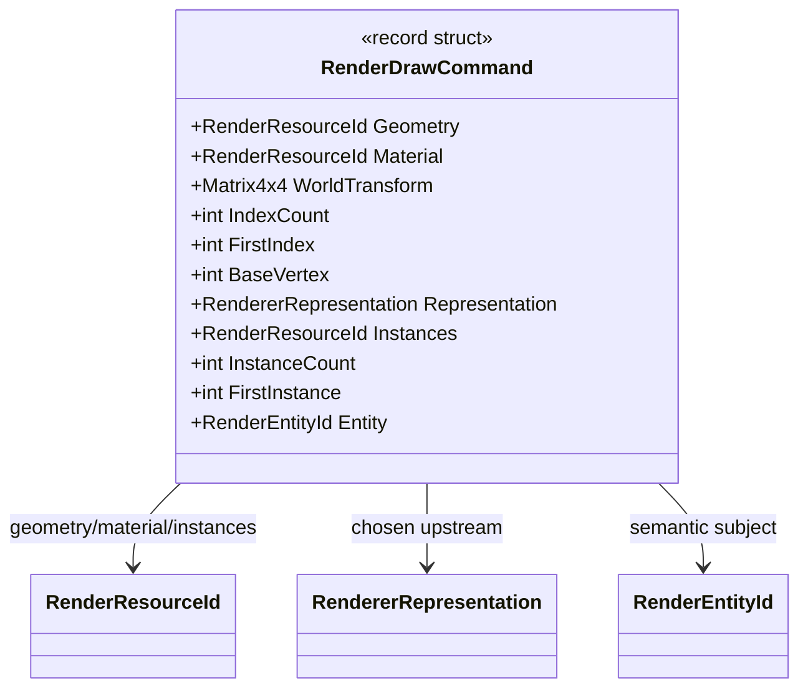

# UML — `RenderDrawCommand.cs`

**Source:** [`RenderDrawCommand.cs`](../../RenderDrawCommand.cs)

## Responsibility

Represents one platform-neutral indexed draw operation, including resource identity, world transform, index range, representation decision, optional instance range, and semantic entity identity.

## Class diagram

## Observed validation

- Geometry and material resource IDs must be valid.
- Every component of the world transform must be finite.
- Index count and instance count must be positive; first index and first instance must be non-negative.
- A non-default instance range requires a valid instance resource.
- `BaseVertex` is stored separately from `FirstIndex`; effective index interpretation belongs to the consumer contract.

## Boundaries

The command is a data record, not a draw call. It does not resolve resources, cull objects, select representation, or call a graphics API.
