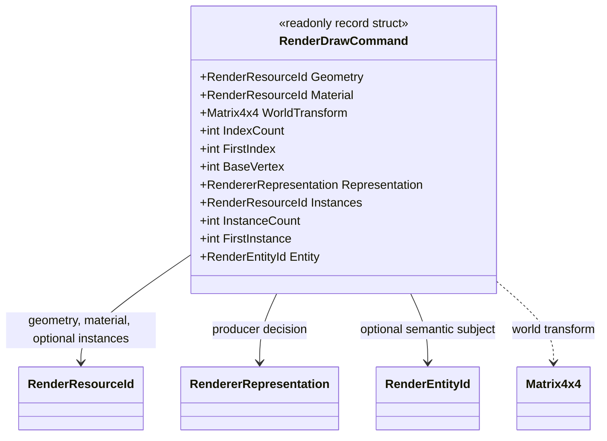

# RenderDrawCommand — class diagram

This diagram documents the current immutable draw-command contract in `RenderDrawCommand.cs`. It is a renderer-neutral data record; it does not issue graphics API calls.

## Use case

A computation stage creates a validated command after deciding what representation to describe. A downstream renderer can consume the geometry/material identifiers, transform, index range, and optional instance range without coupling this contract to Vulkan, WebGPU, or another graphics API.

## Contract boundary

The constructor validates resource identifiers, finite transform components, positive index and instance counts, non-negative first-index/first-instance offsets, and the instance-resource requirement for non-default instancing. `BaseVertex` is retained as a signed offset. This type does not resolve resources, perform culling, choose the representation, or prove GPU execution.
