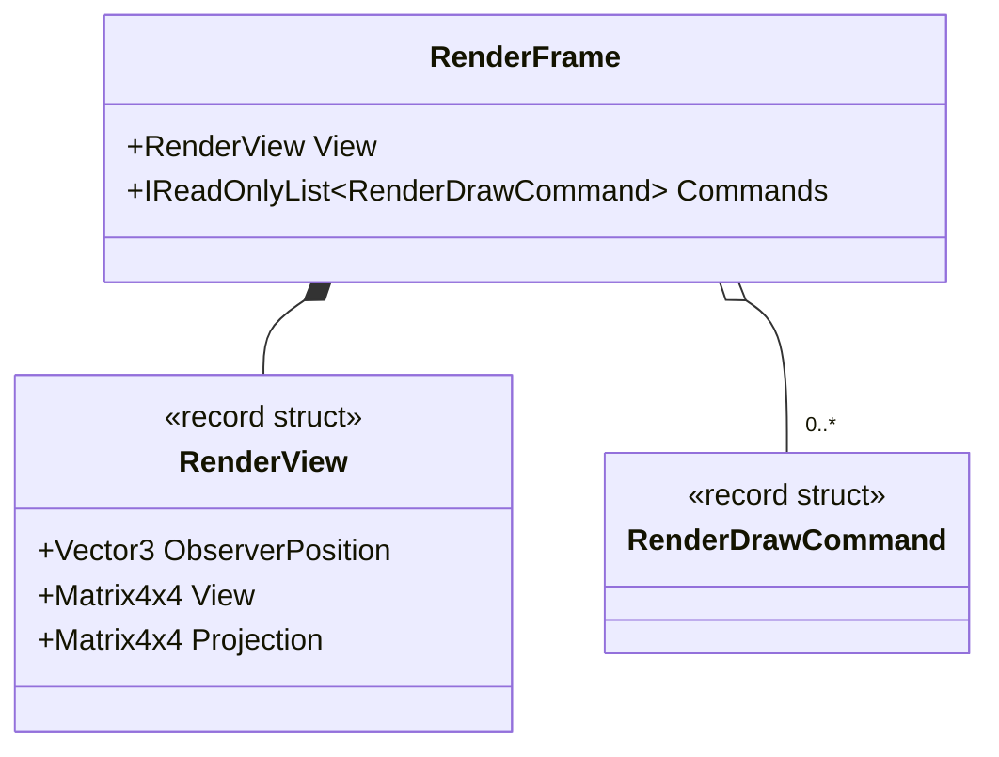

# UML — `RenderFrame.cs`

**Source:** [`RenderFrame.cs`](../../RenderFrame.cs)

## Responsibility

An immutable ordered snapshot of the observer-relative view and draw commands selected for one frame.

## Class diagram

## Observed behavior

- Constructor rejects a null command sequence.
- Commands are copied to an array and exposed through a read-only wrapper; subsequent mutation or reuse of the producer's sequence does not change the frame snapshot.
- The frame is a platform-neutral result of observer-relative rendering decisions. It does not execute drawing or own GPU resources.

## Evidence limits

This type guarantees snapshot semantics at the API boundary. It does not prove that a downstream host consumes the snapshot without additional copies or that the frame is rendered.
