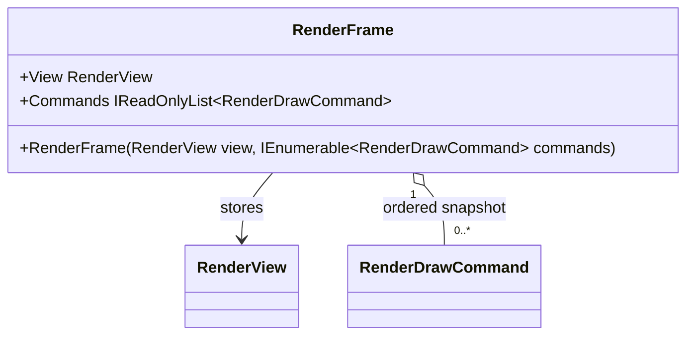

# RenderFrame — UML

**Source:** [`RenderFrame.cs`](../../RenderFrame.cs)  
**Companion and use case:** [RenderFrame.cs.md](RenderFrame.cs.md)

## Structural contract

The constructor materializes the supplied command sequence into an array-backed read-only snapshot. Renderer owns platform-neutral observer decisions and commands; this type does not submit GPU work or create pixels.
