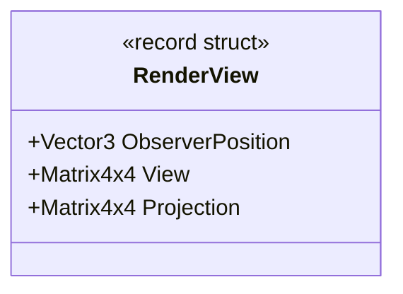

# UML — `RenderView.cs`

**Source:** [`RenderView.cs`](../../RenderView.cs)

## Responsibility

Carries the observer position and world-to-view / view-to-clip matrices required for one observer-relative frame.

## Type diagram

## Observed validation

The constructor rejects non-finite observer coordinates and non-finite values in either matrix. It does not establish that the matrices are invertible, form a valid camera, or use a particular graphics API's clip-space convention.

## Boundaries

This is view data only. It does not perform projection, visibility selection, or rendering.
