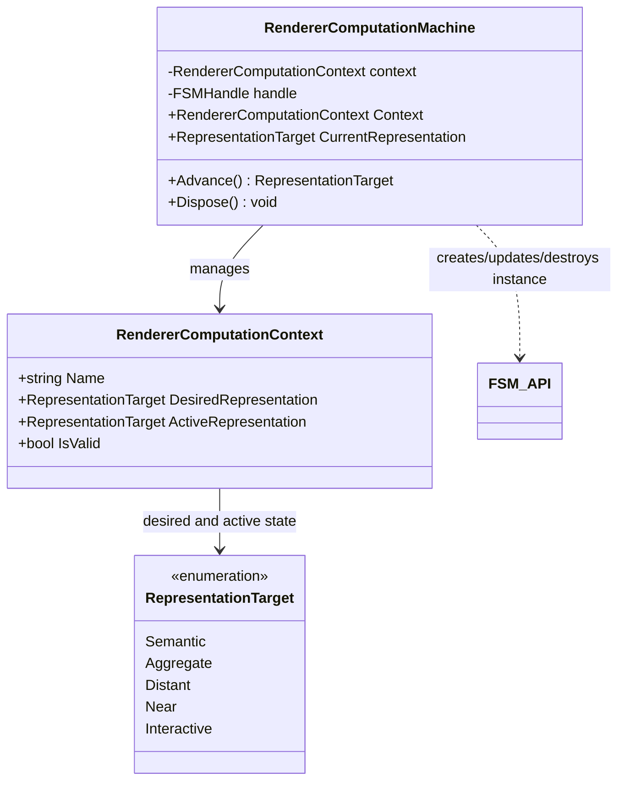

# UML — `RendererComputationMachine.cs`

**Source:** [`RendererComputationMachine.cs`](../../RendererComputationMachine.cs)

## Responsibility

Uses FSM_API to track the computational representation currently active for one observable entity. It is a computation-state boundary, not a graphics object or renderer backend.

## Class diagram

## Observed behavior

- A named context is required; the active representation starts at `Semantic`.
- The shared definition is lazily ensured under a static lock, then each machine creates its own FSM instance in the `Renderer` processing group.
- The FSM definition includes all directed transitions between the five representation targets. A transition predicate checks context validity, requested target, and whether the target is already active.
- `Advance()` rejects use after disposal, updates the FSM handle, and returns the parsed current state.
- `Dispose()` destroys the FSM instance, marks the context invalid, and makes subsequent disposal calls no-ops.

## Important nuance

The transition predicate updates `ActiveRepresentation` when it accepts a transition. The FSM's actual state and the context's active representation therefore depend on the FSM_API transition semantics; keep the FSM integration tests as the executable evidence rather than treating this diagram as a standalone proof.

## Evidence

See [RendererComputationMachineTests.cs](../../tests/TheSingularityWorkshop.Renderer.Tests/RendererComputationMachineTests.cs) and [Renderer living-documentation gallery](../GALLERY.md).
